# Mobile charts: before / after

Before images use the original chart implementation and CSS from main at `ac42d97520f553b8fcf7a080f373ddf0f4d31e7c`, the merge of PR #76. After images use Task 6. Both receive identical deterministic hourly data, including negative temperatures and 0.2 rainfall. No live weather/account services are used.

The adjacent `index.html` provides an offline selector for all four charts, these two representative viewport/language/theme combinations, and no selection / the final hour. Download the directory together to open it locally. Automated coverage additionally checks every requested viewport in both languages and themes.

| 320px · Bulgarian · light · final hour | Before | After |
| --- | --- | --- |
| Temperature | 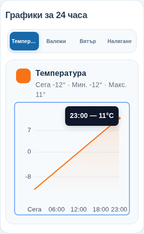 | 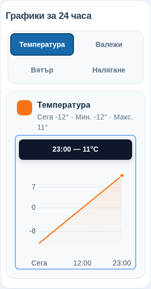 |
| Precipitation | 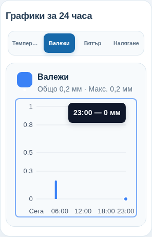 | 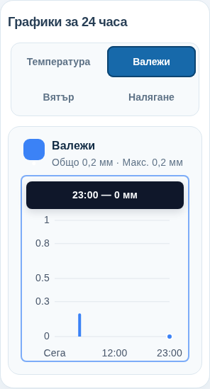 |
| Wind | 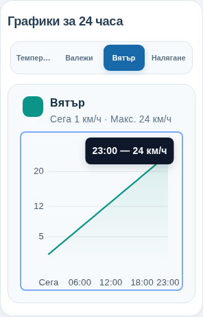 | 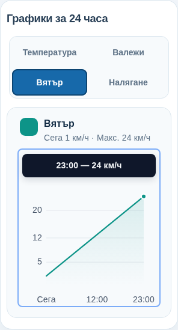 |
| Pressure | 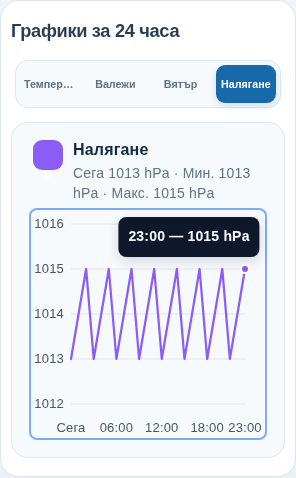 | 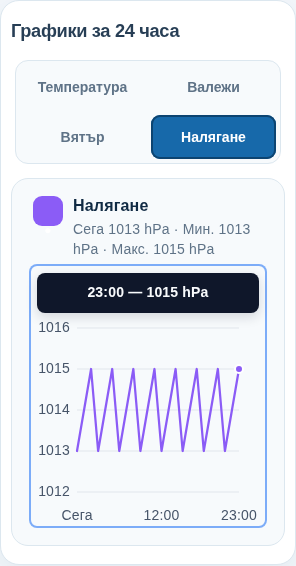 |

| 640px · English · dark · final hour | Before | After |
| --- | --- | --- |
| Temperature | 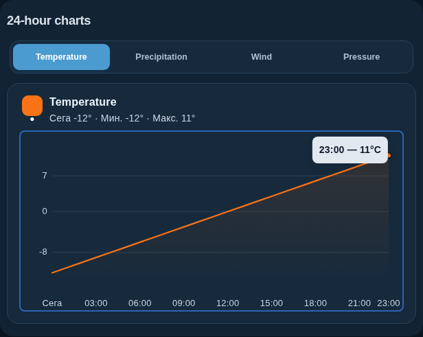 | 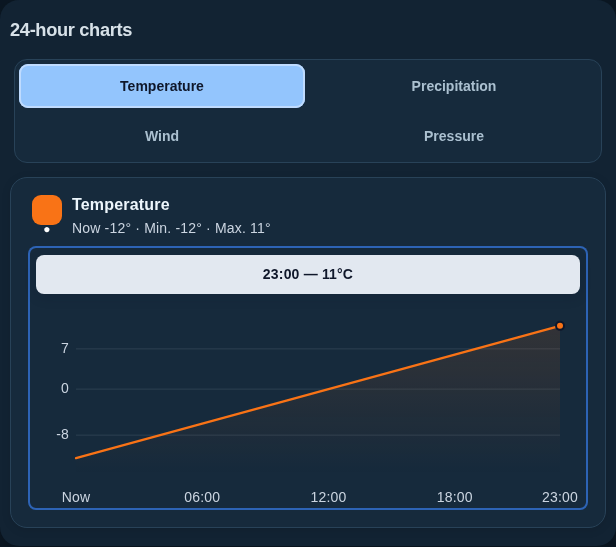 |
| Precipitation | 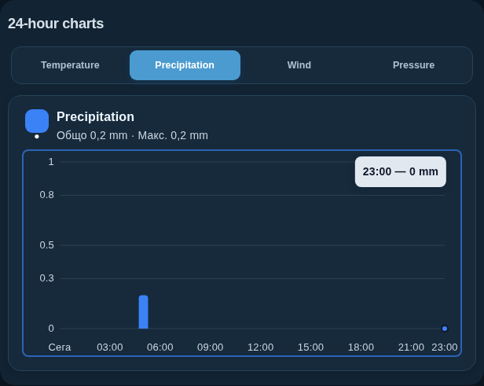 | 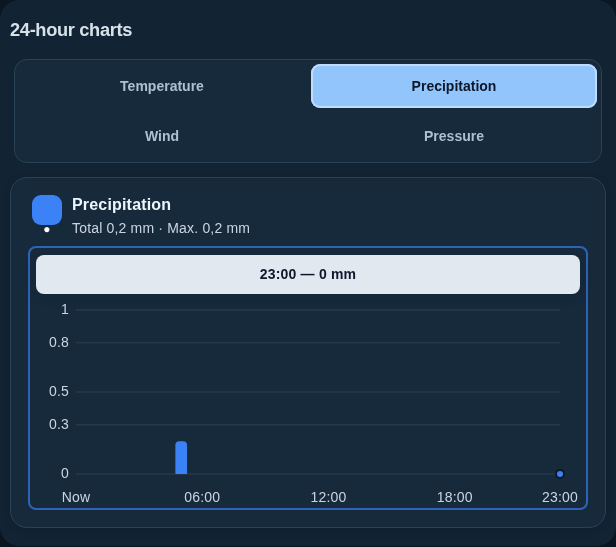 |
| Wind | 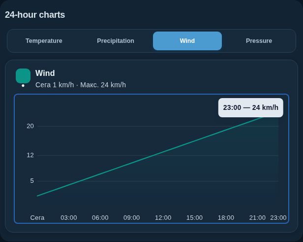 | 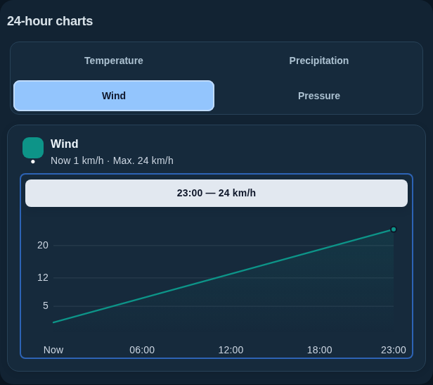 |
| Pressure | 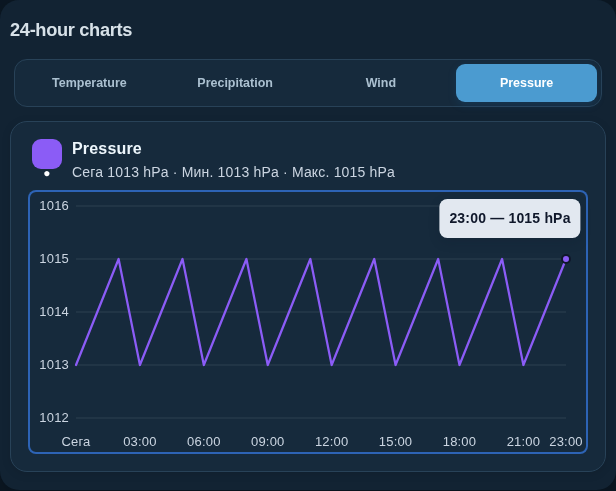 | 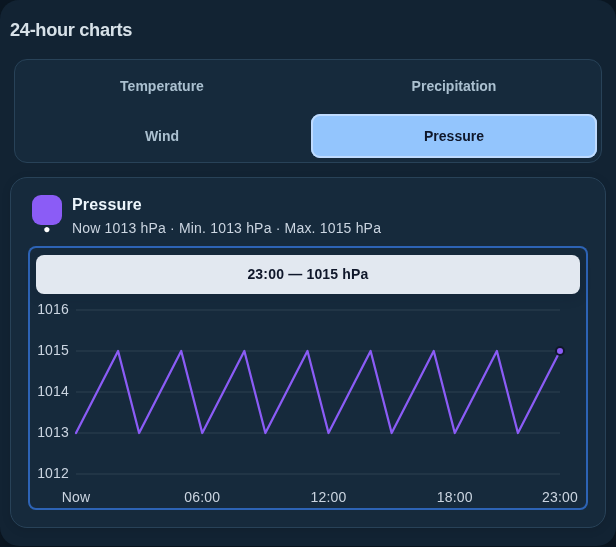 |

The English summaries and “Now” are intentional language corrections, also applied on desktop. Existing values, decimal formatting and units are retained.
