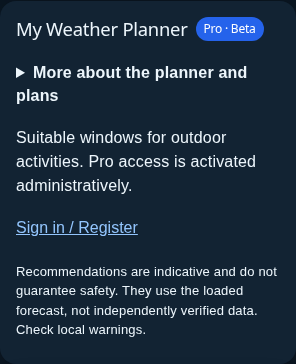
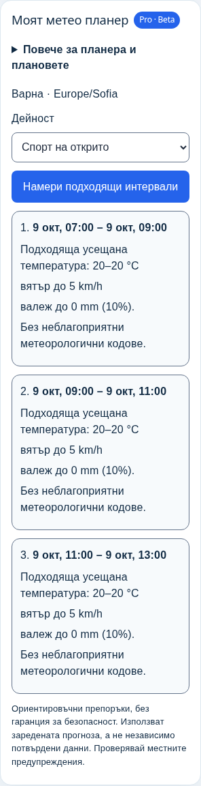
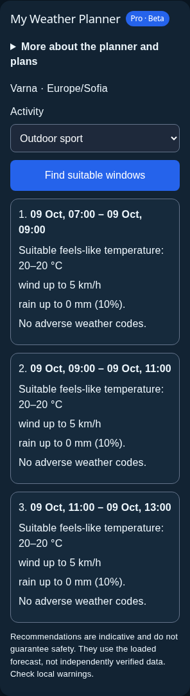

# Task 9: compact mobile weather planner

Base: `33f11215d74a90977141931c2c58cc3e4322a50a` (`main`, merged PR #87).

## Changes

At widths up to and including 640px, the planner uses a smaller heading and padding, a short guest/Free introduction, and a native closed `details` disclosure for the full planner and Free/Pro information. The introduction and disclosure explicitly describe administrative Pro activation. There is no purchase or automatic activation action.

The Pro activity selector retains walk, garden and outdoor sport. Mobile controls have a minimum 44px height. Recommendations use separate cards with every existing time, value and unit. The original safety warning remains outside the disclosure, including when Pro results are shown. Both languages and themes are supported; focus indicators are explicit.

The planner sign-in button calls `AuthPanelHandle.openSignIn()` through an App-owned React ref. It opens the existing AuthPanel login view even when the mobile menu is closed. Authentication retains its existing focus trap, Escape handling and return focus. The original desktop invitation text is retained.

The planner's access effect, request/abort/version guards, calculation handler and date formatter are byte-for-byte unchanged from main. No edits to `/api/profile`, `/api/planner`, server logic, permissions, migrations, weather fetching, charts, Windy, AQI, Push or profile behavior. AuthPanel only exposes its existing login-view action.

The existing planner markup and CSS above 640px are retained. The original desktop metrics paragraph is rendered separately from the mobile metric rows to preserve text rasterization.

## Verification

- `npm run build`: passed (TypeScript and Vite).
- `npm run lint`: passed.
- `npm test`: 335 passed, 1 skipped, 0 failed. The skipped native Deno TLS test requires `DENO_BINARY`, unavailable here. Initial sandbox failures for local process/socket tests were resolved by rerunning with local process access.
- Browser results: **261 passed, 0 failed** — 188 planner cases, 48 navigation cases, 10 profile-plan cases and 15 profile workspace cases.
- Final browser command: `CHROMIUM_PATH=/usr/bin/chromium npx playwright test tests/planner.spec.ts tests/mobile-navigation.spec.ts tests/profile-plan.spec.ts tests/profile-redesign.spec.ts --workers=4 --timeout=60000`.

The planner matrix covers 320, 360, 390, 430, 640, 641, 768 and 1440px, BG/EN, light/dark and guest/Free/Pro. Every combination verifies collapsed plans, expansion, warning visibility and planner overflow; Pro combinations verify activity options, mobile control heights, exact response times/values/units and result cards.

Transient-state scenarios cover pending access, failed access, pending calculation, failed calculation and missing forecast time zone across every width/language/theme combination. Guest keyboard sign-in scenarios cover closed mobile menus, modal focus, Tab containment, Escape and return focus. Existing tests cover insufficient/unsuitable data, retry, server downgrade, expired session and logout during a pending request.

Additional compact-view scenarios at 320/640px cover all plans/languages/themes, all three Pro calculation choices, initial closed disclosure screenshots, text contrast >= 4.5:1 and viewport bounds. Navigation and profile regression suites cover the existing menu, authentication and profile workflows.

An isolated worktree of main was used to capture the original Pro desktop planner at 641/768/1440px in both languages and themes for comparison. All 12 Pro screenshots match main with zero differing pixels and identical image dimensions.

## Limits

All browser checks use headless Chromium and isolated synthetic API responses. Physical touch devices, Safari, Firefox, live authentication/weather/planner APIs, administrative Pro activation and live deployments are not exercised. No SQL or external integration tests were run. The native Deno TLS unit case remains skipped. There was no merge, production deployment, SQL migration or change to secrets.

## Representative initial mobile views

The plan disclosure is closed in these screenshots. Pro examples show results after calculating; every metric and the safety warning remain visible.

| Guest, BG/light, 320px | Guest, EN/dark, 320px |
| --- | --- |
|  |  |

| Pro, BG/light, 320px | Pro, EN/dark, 320px |
| --- | --- |
|  |  |
